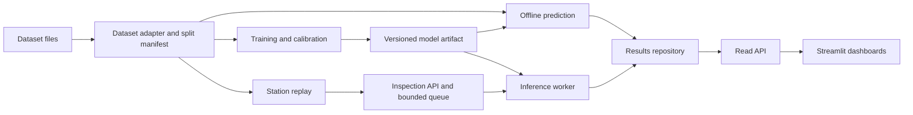

# Implementation roadmap

For working setup and prediction commands, start with [getting started](getting-started.md).


Updated: 9 November 2026. Based on [project goals](project-info.md). The shared notes contain the literature review and implementation decision.

## Direction and implementation order

Build a complete path for one product category first: **load images → fit a model → save and reload it → predict defects and locations → store results → show dashboards**. Add station simulation and continuous updates after that path works. This gives each stage real outputs to build on.

The loader and our PyTorch PatchCore workflow are implemented, including fitting, calibration, artifact reload and prediction. Anomalib code is preserved only as optional reference experiments. Configuration evaluation and the application stages below remain pending.

| Order | Milestone | Concrete output | Completion gate |
| --- | --- | --- | --- |
| 0 | [Foundation and feasibility](#m0) | Reproducible environment and configuration | The selected backbone and feature-bank operations fit available hardware |
| 1 | [Data loader](#m1) | MVTec AD adapter, explicit splits, image/mask preview | Validated samples and batches; no split overlap |
| 2 | [First model and inference](#m2) | PatchCore fit, calibration, checkpoint, prediction commands | A fresh process predicts from a saved artifact |
| 3 | [Evaluation and configuration experiments](#m3) | Evaluation of our PatchCore and its configurations | Configurations use the same declared evaluation protocol |
| 4 | [Results storage and read API](#m4) | Persisted inspections, experiments, and query endpoints | Saved results survive restart and are queryable |
| 5 | [Dashboards](#m5) | Dataset, experiment, and inspection views | A user can inspect data, compare runs, and examine defects |
| 6 | [Live stations](#m6) | Station replay, queued inference, refreshing dashboards | Several simulated stations produce visible persisted results |
| 7 | [Broader validation and handover](#m7) | More products, a second dataset, documented demo | A teammate can reproduce the pipeline and demonstration |

The first technical demonstration is milestone 2. The first usable dashboard demonstration is milestone 5. The original multi-station project goal is complete only after milestones 6–7. These are dependency-based stages; calendar estimates require the course deadline, team availability, and measured training cost.

## Initial scope and technical choices

The core task is normal-only image anomaly detection with localization. Each configured station knows which product category it inspects. The model returns an anomaly score, a decision, and an anomaly map. A map shows suspected defect locations; it does not automatically provide a named defect type or root cause.

Start with MVTec AD `bottle`, then extend to `carpet` and `screw` to cover an object, texture, and small-detail inspection. These categories are a proposed starting selection, not a dataset decision already recorded by the team. Initial development is local on one machine. Record CPU/GPU and memory during milestone 0; choose training limits after the feasibility run.

| Component | Proposed choice | Reason |
| --- | --- | --- |
| ML runtime | Python, PyTorch, torchvision | Implement the detector ourselves using tensor operations and a pretrained feature extractor |
| Selected detector | Our own PatchCore | Implement aggregation, coreset selection, memory-bank search, scoring and maps |
| Experiments | PatchCore configurations | Measure effects of bank size and image resolution without adding another detector |
| Data handling | Dataset adapters and PyTorch data loaders | Separate dataset layout, sample metadata, batching, and model transforms |
| Configuration | YAML files validated into typed configuration | Change dataset, category, model, device, and paths without code edits |
| Backend | FastAPI | Expose inspection results and, later, prediction requests |
| Persistence | SQLite metadata plus local artifact files | Keep a single-machine demonstration easy to run and inspect |
| Dashboards | One Streamlit application with several pages | Build data exploration, configuration comparisons, and station monitoring in Python |
| Verification | Targeted pytest checks and small integration runs | Protect split integrity, artifact reloads, and result consistency |

The selected algorithm is PatchCore, implemented by the team from the [paper](https://arxiv.org/abs/2106.08265). Its fitting constructs a normal-feature bank without optimizing backbone weights. A pretrained ResNet is a feature-extraction building block; feature aggregation, coreset selection, scoring and maps are our work.

PaDiM, DRAEM, EfficientAD and autoencoders stay in the literature comparison. They are not additional implementation milestones. Anomalib is reviewed as an alternative environment, not the target detector runtime. LSTM analysis, learned fusion and product recognition are outside the initial implementation scope.

## Architecture and responsibilities



Training runs as a separate command. The serving process loads approved artifacts once and reuses them. The dashboard queries results through the API; rerendering a page never retrains or reloads a model. Offline predictions and live requests use the same prediction and persistence code.

The common sample contract describes an image and its origin. Model adapters own their required transforms. The common prediction contract is defined by our application. This allows a new dataset or model to be added without rewriting the dashboard.

<a id="m0"></a>

## Milestone 0 — Establish the foundation and remove feasibility risks

**Implement:**

- Create `pyproject.toml`, a locked dependency set, package structure, logging, and validated configuration. Document installation and launch commands.
- Verify Python/PyTorch/torchvision compatibility and available CPU/GPU memory. Cache pretrained backbone weights for the demonstration.
- Run a tiny smoke experiment for our feature extraction and bank search, distinct from a quality evaluation. Confirm that prediction returns an image score and spatial map.
- Record preprocessing, memory, and training constraints before designing defaults.

**Done when:** A documented environment extracts features and runs a small bank search, reporting device, time and memory. Adjust configuration to measured resources before promising throughput.

<a id="m1"></a>

## Milestone 1 — Build the data loader

**Implement:**

1. Acquire MVTec AD through its documented access route and keep raw files unchanged outside version control. Record dataset version, source, categories, and local root.
2. Create an adapter that discovers images, labels, optional pixel masks, and official partitions. Implement file discovery, image/mask loading and split validation with Pillow, NumPy and PyTorch Dataset/DataLoader.
3. Persist a deterministic split manifest. Partition official normal training images into fitting, validation, and calibration subsets with configurable counts/seed; leave official test images untouched. Validation supports model statistics and development; calibration fixes operating thresholds.
4. Validate file readability, dimensions, labels, mask existence where expected, and split disjointness. Keep duplicate images and any views of one physical item in the same partition.
5. Implement batching and model-specific transform hooks. Resize binary masks with nearest-neighbor interpolation and track image geometry so predictions can be mapped back to the source image.
6. Produce a data summary and a grid of image/mask examples. Begin with `bottle`, then check that adding the other categories requires configuration changes only.

**Current loader output:** `image`, `mask`, `label`, `sample_id` and `original_size` in height/width order. The manifest stores image/mask paths, split, label, dimensions and content hashes; category and dataset root come from configuration. Station/event metadata will be added in the application stage. Images are decoded to a consistent RGB representation; the adapter explicitly declares tensor range and shape. Normalize exactly once in the model's preprocessing path. Masks and defect labels are evaluation information; prediction inputs contain only the image and routing metadata.

Use standard dataset/batching abstractions rather than putting filesystem discovery inside training loops. [PyTorch data utilities](https://docs.pytorch.org/docs/stable/data.html).

**Done when:** A validation command reports split counts and issues, preview output visibly aligns images and masks, and a batch can be consumed by our detector. Missing/corrupt input produces a useful error. A targeted check catches cross-split duplicates and incorrect mask resizing.

<a id="m2"></a>

## Milestone 2 — Complete the first fit-to-inference loop

**Implement:**

- Implement PatchCore directly: aggregate and align backbone features, choose a representative coreset, construct the bank, compute neighbour distances, and generate image scores and spatial maps. Use PyTorch operations rather than a ready-made anomaly-detection implementation. Keep model parameters in configuration and retain `train`, `calibrate` and `predict` commands.
- Fit on the normal fitting subset, then finalize any required model statistics using the declared validation subset.
- Determine an image decision threshold on normal calibration examples using a declared target false-alarm rate. Record calibration count and empirical rate; small calibration sets limit threshold precision. Define a separate mask threshold if producing binary regions.
- Save a complete versioned artifact: model state/memory bank, resolved config, preprocessing and geometry rules, fitted statistics, thresholds, split-manifest fingerprint, dependency versions, and training provenance.
- Load that artifact into a fresh process and predict a single image or a folder. Return raw score, threshold, decision, spatial map, model identity, and timing. Save an overlay without rescaling each image's map independently.

Keep inference independent of the training dataset. Reload the extractor weights, bank and preprocessing from the saved artifact without images, labels, masks, validation or refitting. Verify prediction parity in a fresh process.

**Done when:** One configuration produces a model artifact, and a new process uses it to predict unseen input with matching scores/maps within documented numerical tolerance. It outputs a machine-readable result plus an image overlay. Changing only the category configuration repeats the workflow.

<a id="m3"></a>

## Milestone 3 — Evaluate our detector and compare configurations

**Implement:**

- Evaluate our PatchCore on the fixed test split after choosing development settings and calibrating thresholds on separate normal samples.
- Compare coreset ratios first, changing one setting at a time. Then investigate image resolution if small defects are missed and resources permit. Record random seeds, feature layers, bank size and preprocessing.
- Report image AUROC/AP, confusion matrix at the fixed threshold, pixel AP and AU-PRO with a stated integration limit, and success/failure examples. Record fitting time, artifact size, memory and inference latency.
- Measure the model separately from image reading, preprocessing, visualization and end-to-end application time. Start with batch-one inference and declare hardware and warm-up.
- Implement evaluation in our workflow; do not rely on an anomaly-framework engine or silently optimize thresholds on the final test set.

**Done when:** The selected configuration reloads independently and has a reproducible quality/resource report. Comparison is between configurations of the same detector, not an obligation to implement another paper. Published accuracy figures are not project targets or measured results.

<a id="m4"></a>

## Milestone 4 — Persist results and expose a read API

**Implement:**

- Add SQLite tables for experiment/model records, inspection events, and station configuration. Store images, float maps, masks, overlays, manifests, and detailed reports as files referenced by stable artifact IDs.
- Import completed offline predictions through the same result repository that live inference will use. Distinguish benchmark results from simulated operating events.
- Expose read endpoints for dataset summaries/examples, experiments/metrics, inspection lists/details, station summaries, and artifacts. Filters include dataset/category, station, time range, model, and decision; lists use pagination.
- Keep original evaluation truth in an evaluation record, separate from the prediction request. A manually uploaded image may have no truth label.

**Inspection record:** unique `inspection_id`, optional replay `session_id`, source sample/image reference, `station_id` where applicable, product category, model/artifact version, acquisition/received/completed timestamps, processing status, score, threshold, decision, map/overlay references, timing, and simulated measurements with units. Retain `sample_id` separately: replaying an image creates a new inspection event.

A failed inference has an error status and no accept/reject decision. Aggregate reject rate is rejected/completed inspections in the selected window; display failures separately. Model metrics come from labeled evaluation, not from treating every live prediction as correct.

Use a local single-owner write path and transactions. FastAPI supplies typed HTTP endpoints and interactive API documentation. [FastAPI first steps](https://fastapi.tiangolo.com/tutorial/first-steps/).

**Done when:** Stored records survive restart, each result opens its matching image/map, and filtered counts agree with the underlying events. The API has example requests and returns a clear error for an unavailable artifact or unknown model.

<a id="m5"></a>

## Milestone 5 — Build dashboards using saved results

Create one Streamlit app with three initial pages. Use the read API so the UI does not own model execution or database writes. Streamlit supports multipage applications; choose navigation appropriate to the pinned version. [Multipage reference](https://docs.streamlit.io/develop/concepts/multipage-apps/overview).

| Page | Data shown | Main interaction |
| --- | --- | --- |
| Dataset explorer | Categories, split counts, normal/defect distribution, source images and available masks | Filter dataset/category/split and inspect samples |
| Experiments and models | Configuration, training progress/logged history, evaluation metrics, latency, resource use, example predictions | Compare completed PatchCore configurations |
| Inspection monitor | Event history, completed/rejected/failed counts, station/category/model filters, source image and defect overlay | Select an inspection and inspect suspected regions |

Initially populate these from real offline outputs. Add the live station summary, status, and sensor charts in milestone 6. Keep the same inspection detail view for both modes.

Show the threshold next to the score and preserve a stable heatmap color scale per model configuration. Display unknown truth as unknown; only show accuracy/precision where evaluation labels exist. Mark simulated telemetry and replayed images clearly.

**Done when:** A teammate can browse data, inspect a model report, filter saved predictions, and open an original image beside its heatmap/mask without running training. Empty results, missing artifacts, and an unavailable backend have understandable UI states. A small known result set verifies displayed totals and filtering.

<a id="m6"></a>

## Milestone 6 — Add station replay and live inference

**Implement:**

1. Configure simulated stations with IDs, display names, product categories, replay manifests, cadence, random seeds, and simulated temperature or other measurements with units. Route each category to an explicitly selected calibrated artifact.
2. Extend the backend with `POST /inspections`. Accept an image and station metadata, persist a pending request, and return an inspection ID. Labels and masks do not enter the prediction path.
3. Use one bounded queue and inference worker for the first local version. Load the configured artifacts once; reject requests for unconfigured categories. When capacity is exhausted, reject new work with an explicit retryable response and back off in the simulator.
4. Support request IDs so retries do not create duplicate inspections. On restart, mark interrupted in-memory work as interrupted/failed and allow explicit retry; a durable distributed queue is a later requirement.
5. Generate events continuously, persist completed or failed results, and let the UI poll incrementally. Start with approximately two-second refresh and tune it to the demo load. Streamlit fragments can refresh independently on an interval while a session is active. [Refresh mechanism](https://docs.streamlit.io/develop/api-reference/execution-flow/st.fragment).
6. Add station online/stale status from a heartbeat, station-level event counts, simulated sensor history, and current queue/load information. Timestamp telemetry independently if stations should remain visible without inspections.

Keep heavy inference off the API's request event loop; the worker owns model execution. Use one service process initially so queue state and loaded models have a clear owner. Training is a separate operation, and the live demo uses a frozen artifact.

Start with one station, then three at a low configurable rate. Set the final cadence from measured capacity. Test steady load and a burst; record model time, queue wait, end-to-end p50/p95, failures, and throughput. Measure backend completion separately from dashboard visibility because polling adds delay. Use monotonic clocks for local duration measurements.

**Done when:** Three simulated stations send requests, the correct product model handles each request, histories persist, and the dashboard refreshes without retraining. Repeated request IDs do not inflate counts; overload and an interrupted worker produce visible errors rather than a false normal decision.

## Milestone 7 — Broaden validation and prepare the course demonstration

<a id="m7"></a>

**Implement:**

- Complete the agreed MVTec categories and introduce a VisA adapter using the same sample and prediction contracts. Fit category-specific artifacts for the new data; describe this as pipeline portability, not zero-shot transfer.
- Repeat the declared evaluation protocol and document failure cases, including small defects, background responses, and changed appearance. Keep the dashboard and API contracts unchanged.
- Run the final station-load scenario on the documented machine and save its measurements. Keep synthetic defect prevalence separate from benchmark prevalence and state any image resampling in replay.
- Write a short runbook covering dataset acquisition, environment setup, training, calibration, evaluation, inference, service startup, dashboard startup, and station replay. Keep data and large generated artifacts outside Git.
- Prepare a scripted demonstration: explore data → open configuration comparisons → inspect one good and one defective prediction → start stations → observe an event and its suspected defect region.

**Done when:** A teammate can reproduce a small run from the instructions, both datasets use the same pipeline, and the final report includes detection/localization metrics, measured system behavior, and known limitations.

## Proposed repository layout

```text
configs/                     # datasets, models, stations, experiment settings
src/defect_detection/
  data/                      # adapters, manifests, split validation, previews
  models/                    # own PatchCore implementation and artifact loading
  pipeline/                  # train, calibrate, evaluate, predict, rendering
  storage/                   # schema, result repository, artifact references
  api/                       # queries, inspection submission, worker lifecycle
  dashboard/                 # dataset, experiments, inspection/station pages
  simulator/                 # replay clients and telemetry generation
  cli.py                     # project entry point
tests/                       # data integrity and essential integration checks
docs/                        # decisions, runbook, evaluation and demo reports
data/                        # local dataset files; ignored
artifacts/                   # local checkpoints, maps, reports; ignored
runtime/                     # local database and service state; ignored
```

Use basic tensor, image and data-loading facilities; implement the anomaly-detection algorithm within the project. Avoid inventing a general ML framework. The important boundaries are dataset → sample, image → prediction, and prediction → stored event.

## Intended developer workflow

The following commands are implemented by our PyTorch workflow. Run them from the repository root after installing dependencies and preparing the data. `train` writes a new run bundle; `calibrate` adds its thresholds. See the getting-started guide for dataset acquisition, expected outputs and CPU selection.

```bash
uv run --locked defect data validate --config configs/mvtec-bottle.yaml
uv run --locked defect data preview --config configs/mvtec-bottle.yaml
uv run --locked defect train --config configs/mvtec-bottle-patchcore.yaml --run-id bottle-native-001
uv run --locked defect calibrate --artifact artifacts/bottle-native-001 --config configs/mvtec-bottle.yaml
uv run --locked defect predict --artifact artifacts/bottle-native-001 --input data/mvtec_ad/bottle/test/broken_large/000.png --output artifacts/prediction-001
```

The commands below are **planned interfaces, not available commands**. Their syntax may change during the corresponding milestones:

```text
defect evaluate --artifact artifacts/bottle-native-001 --split test
defect api --config configs/local.yaml
defect dashboard --config configs/local.yaml
defect simulate --config configs/stations.yaml
```

Support the same operations as callable Python functions for notebooks. A detector-configuration change should require a new run, and a product change should require a dataset/category configuration plus a compatible calibrated artifact. Training remains outside dashboard refresh and request handling.

## Implementation checklist and priority

- [x] 0. Environment, configuration, model feasibility checks.
- [x] 1. Dataset adapter, persisted splits, loader validation, previews.
- [x] 2. PatchCore fitting, normal-only calibration, artifact reload, single/folder inference.
- [ ] 3. PatchCore evaluation, configuration comparisons and measured operating settings.
- [ ] 4. Durable results and read API.
- [ ] 5. Three dashboard pages showing actual pipeline outputs.
- [ ] 6. Station replay, bounded inference queue, live monitoring, load measurements.
- [ ] 7. Additional categories, VisA adapter, reproducible runbook and final demo.

Milestones 0–2 have been verified. Continue with milestone 3: configuration evaluation of our detector, followed by result storage and dashboards. The highest-value integration checkpoint is a saved model producing a persisted inspection that the dashboard can display. Add temporal or multimodal experiments only after that full path and the live-station demonstration are reliable.
